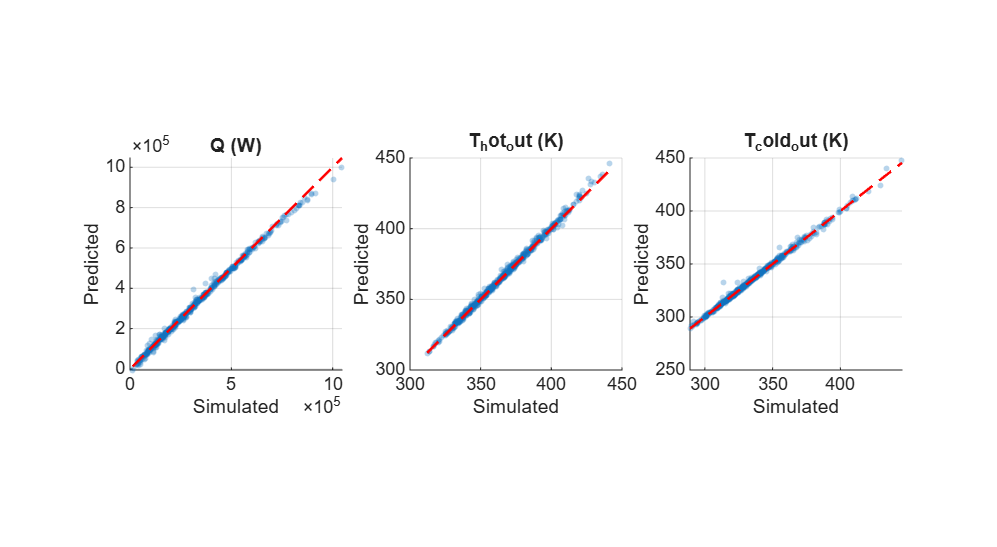
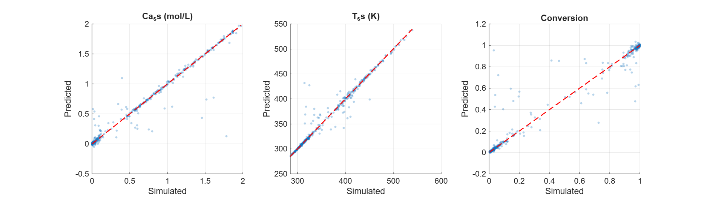

# Neural Surrogates for Chemical Process Simulation

When is it worth replacing a physics simulation with a neural network?

This project trains surrogate models for two chemical engineering systems and
benchmarks them against the physics they replace. The answer turns out to depend
entirely on how expensive the original simulation is.

## Results

| System | Physics model | Physics cost | Surrogate R² | Speedup |
|---|---|---|---|---|
| Shell-and-tube heat exchanger | Effectiveness-NTU (closed form) | 0.32 µs/point | 0.996 | **0.014×** (73× *slower*) |
| Non-isothermal CSTR | ODE solve (`ode45`) | 10.35 ms/point | 0.94–0.96 | **1,080×** |

The surrogate is *more* accurate on the heat exchanger and *less* accurate on the
CSTR — but only the CSTR surrogate is worth deploying. A 128-neuron network costs
~10 µs per forward pass. That is far more than evaluating a handful of exponentials,
and far less than integrating a stiff ODE system.

### Detailed accuracy

**Heat exchanger** (3,000 samples, 6 inputs → 3 outputs)

| Output | R² | MAE |
|---|---|---|
| Duty Q | 0.9966 | 7,740 W |
| Hot outlet temp | 0.9959 | 1.18 K |
| Cold outlet temp | 0.9962 | 0.94 K |



**CSTR** (1,946 samples after cleaning, 6 inputs → 3 outputs)

| Output | R² | MAE |
|---|---|---|
| Steady-state concentration | 0.9435 | 0.045 mol/L |
| Steady-state temperature | 0.9620 | 4.12 K |
| Conversion | 0.9498 | 0.033 |



Predicted against simulated values on the held-out test set. The dashed line is
perfect agreement. Residual spread in the CSTR plots concentrates near the ignition
transition, where the response surface is close to discontinuous.

## The two systems

**Heat exchanger.** Counter-current shell-and-tube unit solved by the
effectiveness-NTU method. Inputs: hot and cold flow rates, both inlet temperatures,
heat transfer area, overall heat transfer coefficient. The solution is algebraic —
a few exponentials — so it is extremely cheap to evaluate.

**CSTR.** Non-isothermal continuous stirred-tank reactor with an exothermic
first-order reaction A → B and a cooling jacket. Concentration and temperature are
coupled through Arrhenius kinetics, so there is no closed form; each operating point
requires integrating the ODE system to steady state. Inputs: flow rate, feed
concentration, feed temperature, coolant temperature, reactor volume, heat transfer
term.

Operating envelopes were sampled uniformly and span the full range of behaviour —
CSTR conversion runs from 0.002 to 1.000 and steady-state temperature from 285 K to
553 K, covering both near-dead reactors and thermal runaway.

## Method

- Uniform random sampling of the operating envelope
- 80/20 train/test split
- Input and output standardisation (critical: the heat transfer coefficient is ~1000
  while flow rates are ~1; without scaling the large-magnitude inputs dominate the
  gradients)
- Feedforward network, 6 → 128 → 128 → 64 → 3, ReLU activations
- Adam, piecewise learning-rate decay
- Accuracy reported on the held-out set in original physical units
- Timing measured over repeated batches

## Why CSTR accuracy is lower

The CSTR is genuinely nonlinear. Near the ignition point, a small change in coolant
temperature or feed rate causes a large jump in steady-state temperature — the
reactor either lights off or does not. A smooth feedforward network cannot represent
that transition sharply, so most of the residual error concentrates in this region.
The heat exchanger has no such behaviour; its response surface is smooth everywhere,
which is why R² is higher despite the surrogate being less useful.

## Limitations

- **Conversion is bounded [0, 1] but the network does not know that.** Predictions can
  fall slightly outside the physical range. A sigmoid output head or a constrained
  loss would fix this.
- **2.7% of CSTR solves returned NaN or Inf** and were removed. These are stiff cases
  where `ode45` fails. Dropping them biases the training set away from the hardest
  region of the operating envelope — arguably the region where a surrogate would be
  most useful.
- **Single architecture, no hyperparameter search.** The network size was chosen by
  inspection, not tuned.
- **Timing is CPU-only**, measured in MATLAB Online. A GPU would widen the speedup
  further, since the ODE solve is inherently sequential.
- **Uniform sampling** is not optimal. Adaptive or active sampling near the ignition
  boundary would likely improve CSTR accuracy for the same data budget.

## Running it

Requires MATLAB with the Deep Learning Toolbox.

```
generate_hx_data.m      % writes heat_exchanger_data.csv
train_surrogate.m       % trains, benchmarks, writes parity_plots.png

generate_cstr_data.m    % writes cstr_data.csv (~21 s for 2,000 points)
train_cstr.m            % trains, benchmarks, writes cstr_parity.png
```

## Takeaway

Surrogate modelling is often presented as a straightforward win. It is not. The
network has a fixed inference cost, and that cost only pays off when the physics it
replaces is more expensive than the forward pass. For closed-form models it is
strictly worse. For ODE-based models it is 1,000× better. Knowing which regime you
are in before building the surrogate is the useful part.
